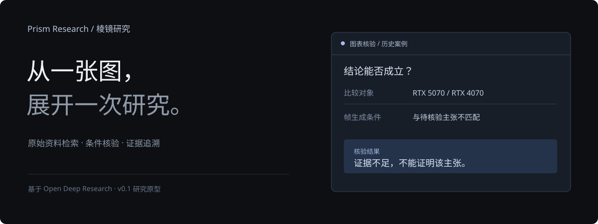
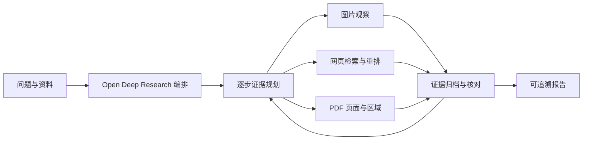

<p align="center"></p>

# Prism Research

**从图像线索出发，让研究过程与证据一起留下来。**

A multimodal research agent built on Open Deep Research, with staged retrieval, evidence planning, and document-region citations.

Prism Research 将图片观察、网页检索和文档研究连接到同一条证据链。每一步记录子问题、工具选择、来源与中间结果，最终输出可追溯的中文报告。

## 能力

- **图像辅助检索**：结合问题与已登记图片改写查询，筛选候选资料后读取原文；支持附加候选网页截图。
- **逐步证据规划**：根据已有结果选择下一步，关联子问题、模态、依赖、证据与待确认项。
- **页面与区域引用**：检索 PDF 相关页，读取文字与页面图像，点击报告引用查看原页区域。
- **可追溯报告**：保存来源、内容哈希、模型观察和步骤记录；报告中的引用编号必须来自实际证据。
- **有界执行**：请求前预留预算，限制检索次数与研究步数，记录失败和停止原因。

## 快速体验

Python 3.11，项目目录执行：

```bash
python -m venv .venv
# Windows: .venv\Scripts\activate
# macOS / Linux: source .venv/bin/activate
python -m pip install -e ".[dev]"
prism-research demo
```

命令打印可直接打开的 `report.html` 路径。离线演示使用合成资料和固定模型结果，无需密钥；可以查看区域引用与完整步骤记录。

使用 uv 时：`uv sync --locked --extra dev`，再执行 `uv run prism-research demo`。

## 使用自己的资料

复制 `.env.example` 为 `.env` 并配置自己的模型 API。

```bash
# 图像研究
prism-research research --question "这张图表达了什么，哪些结论需要额外证据？" --image chart.png

# 加入网页检索（百炼 Qwen3.5）
prism-research research --question "核对图中的测试条件与原始来源" --image chart.png --web

# 文档研究
prism-research research --question "实验采用了什么条件？" --pdf study.pdf
```

研究过程写入新的 `runs/` 子目录，包含 `events.jsonl`、`mcsearch_trace.json`、`report.json` 和 `report.html`。调用使用你自己的 API 额度；`--max-requests` 控制单次运行请求上限。

## 系统结构



| 方法来源 | 接入位置 | 实际适配 |
|---|---|---|
| Open Deep Research | `deep_researcher.py` | 沿用研究提纲、Supervisor 和报告图编排 |
| MMSearch | `mmsearch_adapter.py` | 图像辅助查询、候选筛选、原文摘要 |
| MC-Search | `mcsearch_protocol.py` / `mcsearch_adapter.py` | 复用动作解析器，连接现有工具及逐步证据状态 |
| MPMQA | `mpmqa_scoring.py` / `document_retrieval.py` | 适配 token 交互评分，连接页面检索与区域引用 |

## 开发与验证

```bash
python -m pytest -q
```

离线检查覆盖协议解析、工具路由、预算、证据编号、文档区域与完整 Agent 图数据通路。测试结果是工程验证，不作为模型准确率或论文基准成绩。

- [运行配置](docs/runtime.md)
- [代码与方法对应关系](docs/implementation-status.md)
- [开源组件与许可](NOTICE)
- [展示页面](site/index.html)

## 致谢与许可

基于 [LangChain Open Deep Research](https://github.com/langchain-ai/open_deep_research)。参考并致谢 [MMSearch](https://github.com/CaraJ7/MMSearch)、[MC-Search](https://github.com/YennNing/MC-Search)、[MPMQA](https://github.com/AIM3-RUC/MPMQA)。

项目以 MIT 许可分发。来自第三方的组件保留原许可与署名，详见 [NOTICE](NOTICE)。
