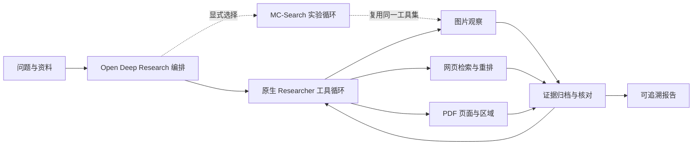

<p align="center"></p>

# Prism Research

**从图像线索出发，让研究过程与证据一起留下来。**

A multimodal research agent built on Open Deep Research, with staged retrieval, evidence planning, and document-region citations.

Prism Research 在 Open Deep Research 原有的规划与迭代研究流程中接入图片观察、网页检索和文档工具，保存证据来源与运行记录，输出可追溯的中文报告。MC-Search 动作循环作为可选实验方案保留。

[在线展示](https://xyl-0216.github.io/prism-research/) · [源码仓库](https://github.com/xyl-0216/prism-research)

[2026-10-28 更新说明](CHANGELOG.md)：交互式多轮 CLI、会话恢复、PDF API 检索、长期记忆与上下文压缩。

## 能力

- **图像辅助检索**：结合问题与已登记图片改写查询，筛选候选资料后读取原文；支持附加候选网页截图。
- **迭代研究**：沿用 Open Deep Research 的 Supervisor / Researcher 流程，按问题调用多模态工具。
- **页面与区域引用**：检索 PDF 相关页，读取文字与页面图像，点击报告引用查看原页区域。
- **可追溯报告**：保存来源、内容哈希、模型观察和步骤记录；报告中的引用编号必须来自实际证据。
- **有界执行**：请求前预留预算，限制检索次数与研究步数，记录失败和停止原因。
- **商品研究**：可从图片或型号出发，搜索指定网站的购买来源，核对页面报价，并结合用途与预算总结性价比；无法核验时保留缺口。

## 快速体验

Python 3.11，项目目录执行：

```bash
python -m venv .venv
# Windows: .venv\Scripts\activate
# macOS / Linux: source .venv/bin/activate
python -m pip install -e ".[dev]"
prism-research demo
```

命令打印可直接打开的 `report.html` 路径。离线演示使用合成资料和固定模型结果，无需密钥；可以查看区域引用与完整步骤记录。

使用 uv 时：`uv sync --locked --extra dev`，再执行 `uv run prism-research demo`。

## 使用自己的资料

复制 `.env.example` 为 `.env` 并配置自己的模型 API。

需要连续对话时运行 `prism-research chat`。普通输入用于聊天和追问，`/attach 路径` 添加图片或 PDF，`/research 问题` 执行完整研究，`/report` 查看报告，`/exit` 保存退出。用 `prism-research chat --list` 查看历史，`prism-research chat --resume 会话ID` 恢复。支持流式回答、研究进度和会话总请求上限，详见[交互式 CLI 使用说明](docs/chat.md)。

当前默认使用 `qwen3.5-flash`、16 次请求上限及一次完整问题委派，便于低成本调试。先跑离线测试，再按需做小样本 API 联调；`--model` 和 `--research-rounds` 可覆盖模型与研究轮次。

CLI 已接入本地 SQLite 长期记忆与按阈值触发的动态上下文压缩。记忆按项目隔离，压缩复用 LangChain 中间件并计入调用预算。使用方式、官方参考、已验证边界见[记忆与上下文管理](docs/memory-context.md)。

```bash
# 图像研究
prism-research research --question "这张图表达了什么，哪些结论需要额外证据？" --image chart.png

# 加入网页检索（百炼 Qwen3.5）
prism-research research --question "核对图中的测试条件与原始来源" --image chart.png --web

# 文档研究：API 页面重排 + 较低价格的视觉问答模型，无需本地 URA 权重
prism-research research --question "实验采用了什么条件？" --pdf study.pdf --pdf-backend api-rerank --model openai:qwen3.5-flash

# 商品研究：图片可选，自动启用网页搜索
prism-research research --shopping --image product.jpg --question "研究这款商品的功能、购买来源和性价比" --usage "日常通勤" --purchase-budget 1200
```

商品模式沿用现有工作流，新增购买来源总结、性价比分析和带原文引用的报价表。默认中国大陆市场，最多两次搜索；电商页面需要登录或无法读取时不编造价格。网站范围、完整命令和验证边界见[商品研究使用说明](docs/shopping.md)。

默认使用 `--planner native`（Open Deep Research）；显式添加 `--planner mcsearch` 可运行实验性的 MC 动作循环。两种方式复用相同证据工具、预算账本与报告引用校验；尚未通过对照实验确定哪种编排方式效果更好。

PDF API 后端最多 40 页，按页面图片重排并保留原有区域引用；切换 `--pdf-backend ura` 可使用作者模型。后端配置、合成资料联调和费用估算见[运行配置](docs/runtime.md#pdf-api-检索无需本地权重)。

研究过程写入新的 `runs/` 子目录，包含 `events.jsonl`、`report.json` 和 `report.html`；MC 实验模式另写 `mcsearch_trace.json`。调用使用你自己的 API 额度；`--max-requests` 控制单次运行请求上限。

## 系统结构



| 方法来源 | 接入位置 | 实际适配 |
|---|---|---|
| Open Deep Research | `deep_researcher.py` | 默认主流程；沿用研究提纲、Supervisor 委派与 Researcher 工具循环 |
| MMSearch | `mmsearch_adapter.py` | 图像辅助查询、候选筛选、原文摘要 |
| MC-Search（可选实验） | `mcsearch_protocol.py` / `mcsearch_loop.py` / `mcsearch_adapter.py` | 复用动作解析器，适配多轮检索流程用于编排对照；并非新增原框架缺失的多步规划能力 |
| MPMQA | `pdf_backend.py` / `mpmqa_backend.py` / `mpmqa_worker.py` / `document_retrieval.py` | 保留检索后问答与区域引用；`ura` 接入作者模型，需独立环境与权重；`api-rerank` 使用百炼页面重排替代检索模型，见[运行配置](docs/runtime.md) |

## 开发与验证

```bash
python -m pytest -q
```

离线检查覆盖协议解析、工具路由、预算、证据编号、文档区域与完整 Agent 图数据通路。测试结果是工程验证，不作为模型准确率或论文基准成绩。

- [运行配置](docs/runtime.md)
- [系统设计与方法实现](docs/architecture.md)
- [开源组件与许可](NOTICE)
- [在线展示](https://xyl-0216.github.io/prism-research/)

新增工具请提供离线边界测试，覆盖未知证据编号、预算耗尽和截断输出；提交前运行测试与 `prism-research demo`。新增第三方代码需保留来源版本、许可证与改动说明，请勿提交 `.env`、API Key、真实运行资料或未经许可的数据。

网站源码位于 `site/`，推送 `main` 后由 GitHub Actions 自动发布，并生成页面使用的源码下载包。本地打包可先暂存需要发布的文件，再执行 `python scripts/build_release.py`；脚本仅归档 Git 已跟踪的文件。

## 致谢与许可

基于 [LangChain Open Deep Research](https://github.com/langchain-ai/open_deep_research)。参考并致谢 [MMSearch](https://github.com/CaraJ7/MMSearch)、[MC-Search](https://github.com/YennNing/MC-Search)、[MPMQA](https://github.com/AIM3-RUC/MPMQA)。

项目以 MIT 许可分发。来自第三方的组件保留原许可与署名，详见 [NOTICE](NOTICE)。
